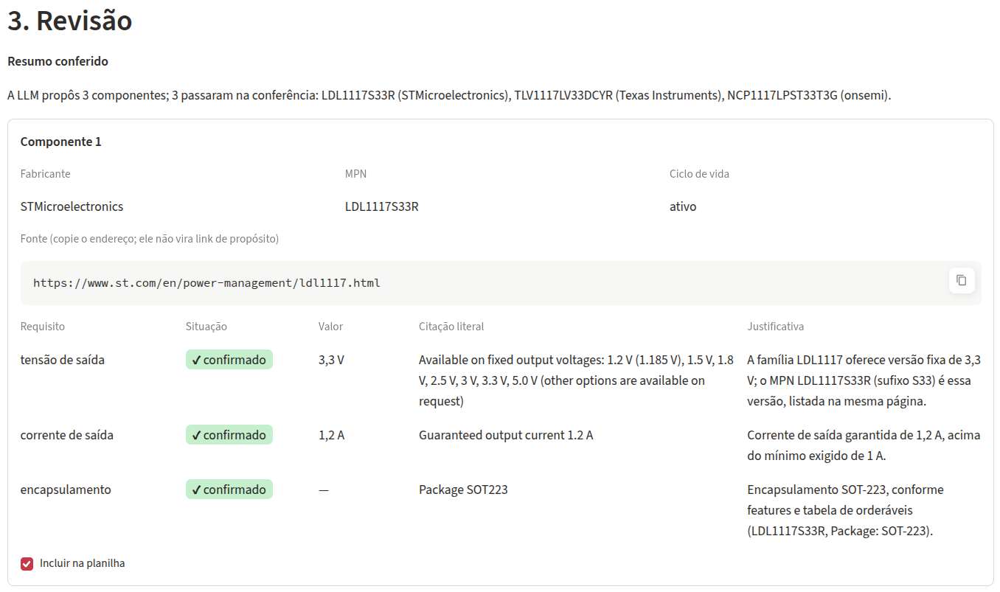
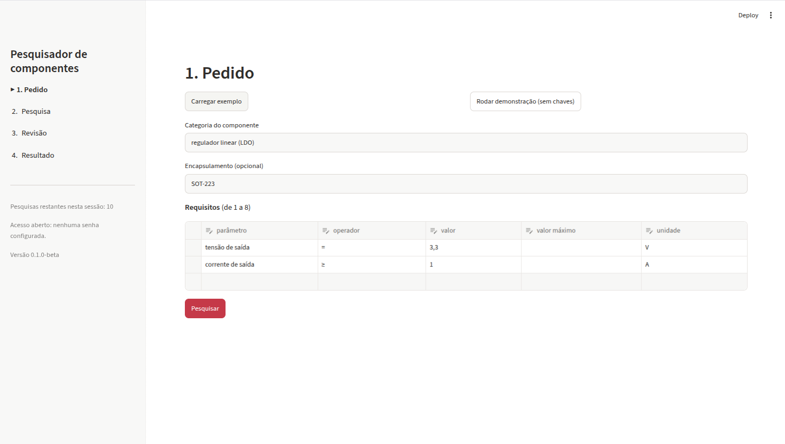
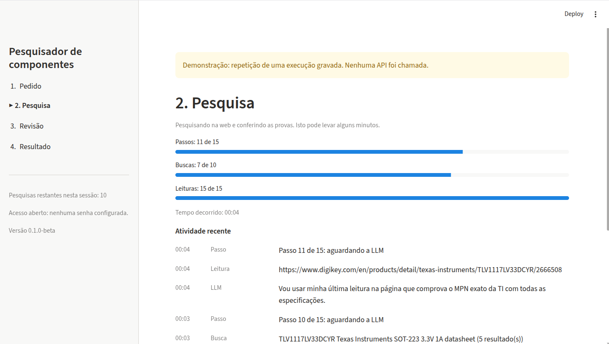
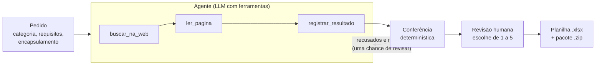

# Pesquisador de componentes eletrônicos

Acha componentes eletrônicos que atendem a uma especificação, com cada afirmação provada por uma citação conferida
pelo código.




<details>
<summary>Ver as outras etapas (pedido e pesquisa ao vivo)</summary>

**Etapa 1: o pedido**



**Etapa 2: a atividade ao vivo**



</details>


## Por que este projeto existe

Este repositório é a versão pública e simplificada de um sistema construído para um caso corporativo que não podia ser
exposto. O sistema original é uma versão mais complexa e faz parte do meu trabalho enquanto estagiário em Desenvolvimento de Software e IA na FDTE (Fundação para o Desenvolvimento Tecnológico da Engenharia), onde fui responsável pelo escopo completo, desde a análise de requisitos até o deploy. Para conseguir mostrar meu trabalho sem expor aquele caso, o domínio foi trocado por um neutro: buscar na web por componentes eletrônicos
escolhidos por especificação, com datasheets públicos como fonte. O sistema estrutura os dados encontrados para se adequar ao esquema de uma planilha final, que é gerada automaticamente.

O que interessa aqui é a arquitetura. Agentes de LLM são bons para buscar, ler e propor. Além de lidarem bem com grandes quantidades de dados pouco estruturados (como textos de páginas da web). Por outro lado, costumam inventar com facilidade.
Por isso a LLM só **propõe**: cada componente vem com citações das páginas que ela leu, e um código determinístico
**confere** se cada citação existe na página, se os números batem com o pedido e se o código da peça aparece na fonte.
No fim, uma **pessoa** revisa as provas e escolhe o que vai para a planilha (a revisão humana foi uma exigência do sistema original, pois envolve decisões técnicas mais específicas).

## O que ele faz



1. **Pedido**: a categoria (ex.: "regulador linear (LDO)"), de 1 a 8 requisitos (parâmetro, operador ≥ ≤ = ou faixa,
   valor e unidade) e, opcionalmente, o encapsulamento.
2. **Agente**: a LLM busca na web (Tavily), lê páginas e registra os componentes com uma evidência por requisito,
   cada uma com uma citação literal da página lida. O ciclo tem orçamento de passos, buscas e leituras.
3. **Conferência**: o código confere cada registro (detalhes em [docs/regras.md](docs/regras.md)) e devolve à LLM os
   recusados com o motivo.
4. **Revisão**: a tela mostra cada componente válido com as provas, os recusados, os alertas e o comentário da LLM
   (rotulado como não conferido). A pessoa escolhe de 1 a 5 componentes.
5. **Resultado**: uma planilha `.xlsx` e um pacote `.zip` com a planilha, o registro completo da pesquisa (JSON) e o
   pedido.

## Experimente sem chaves

A execução real do projeto envolve o uso de chaves de duas APIs pagas:
- [Tavily](https://www.tavily.com/): fornece as ferramentas de busca e leitura na web com fácil comunicação com agentes LLM.
- [Together AI](https://www.together.ai/): fornece a interface para a invocação de modelos de linguagem abertos.

Por isso, aqui o repositório oferece uma forma de simular a execução gratuitamente, usando um exemplo real que foi produzido no fluxo completo. Mas caso você queira realmente executar suas próprias pesquisas, [as instruções estão aqui](#rodar-com-suas-chaves).

Três formas, nenhuma chama API nem precisa de `.env`:

```bash
# (a) a suíte de testes: LLM e buscador simulados, sem rede
python -m unittest discover -s tests -t .

# (b) a demonstração no terminal: repete uma execução real gravada (exemplos/execucao_gravada.json)
python -m backend.pesquisa.demo

# (c) a interface: abra http://localhost:8501 e clique em "Rodar demonstração (sem chaves)"
streamlit run frontend/app.py
```

A demonstração não é uma animação: só a LLM, a busca e a leitura são trocadas por versões que devolvem o que foi
gravado. O ciclo do agente, a conferência, o registro, a planilha e o pacote são os reais. Se o código pedir algo que a
gravação não tem, ela para com uma mensagem clara em vez de inventar resposta. Na interface, um aviso no topo de todas
as etapas diz que é uma demonstração, e a planilha gerada leva o mesmo aviso.

(Os comandos acima pressupõem o ambiente instalado: veja os passos 1 a 4 da próxima seção.)

## Rodar com suas chaves

> **Atenção: cada pesquisa usa as SUAS chaves e gasta créditos.** Na gravação de referência, uma pesquisa custou
> cerca de US$ 0,03 a 0,05 e levou de 4 a 6 minutos, com o modelo GLM-5.3-Flash da Together. Os valores variam.
> O custo mostrado pelo sistema é uma **estimativa**, com preços de referência fixos no código
> (`backend/pesquisa/registro.py`); confira a tabela de preços do provedor.

1. **Requisitos**: Python 3.12 (a versão em que o projeto é desenvolvido e testado no CI; versões anteriores não
   foram testadas) e `git`.
2. **Clone o repositório**:
   ```bash
   git clone https://github.com/cauelemes/pesquisador-de-componentes.git
   cd pesquisador-de-componentes
   ```
3. **Crie e ative um ambiente virtual**:
   ```bash
   python3.12 -m venv .venv
   source .venv/bin/activate          # no Windows: .venv\Scripts\activate
   ```
4. **Instale as dependências**: `pip install -r requirements.txt` (as versões são as testadas, fixadas com `==`)
5. **Crie o seu `.env`** a partir do modelo: `cp .env.example .env`
6. **Crie as duas chaves**:
   - **Together AI** (a LLM do agente): crie uma conta em together.ai e gere uma chave de API nas configurações da
     conta.
   - **Tavily** (a busca e a leitura de páginas): crie uma conta em tavily.com e copie a chave de API do painel.
7. **Preencha** `TOGETHER_API_KEY` e `TAVILY_API_KEY` no `.env`.
8. **Rode pelo terminal** (mostra a atividade ao vivo e salva o registro completo):
   ```bash
   python -m backend.pesquisa.testar_agente exemplos/pedido_regulador.json --salvar tmp_debugs/minha_pesquisa.json
   ```
   Opções úteis: `--max-passos N`, `--silencioso`, `--modelo ID`, `--esforco low|high|max`, `--timeout SEGUNDOS`.
   A pasta `tmp_debugs/` é ignorada pelo git.
9. **Ou rode a interface**: `streamlit run frontend/app.py` e abra http://localhost:8501. O servidor escuta só em
   `localhost` (`.streamlit/config.toml`).

Cuidados:

- **Nunca commite** o `.env` nem o `.streamlit/secrets.toml` (os dois estão no `.gitignore`). Veja
  [SECURITY.md](SECURITY.md).
- **Senha de acesso opcional**: copie `.streamlit/secrets.toml.example` para `.streamlit/secrets.toml` e defina
  `senha_de_acesso`. Sem esse arquivo, a interface abre sem pedir senha (e avisa isso no menu lateral).
- **Limite de 10 pesquisas por sessão**: é só um freio contra uso acidental. Recarregar a página começa uma sessão
  nova e zera a contagem: não é uma cota de segurança.

## Resultados reais

A execução de referência (o pedido de `exemplos/pedido_regulador.json`, gravado em `exemplos/execucao_gravada.json`):

| | |
|---|---|
| Pedido | regulador linear (LDO), tensão de saída = 3,3 V, corrente de saída ≥ 1 A, encapsulamento SOT-223 |
| Componentes válidos | 3, de 3 fabricantes: LDL1117S33R, TLV1117LV33DCYR e NCP1117LPST33T3G |
| Evidências | 9 de 9 confirmadas, cada uma com uma citação literal da página lida |
| Passos da LLM | 11 de 15 (7 buscas e 15 leituras) |
| Tempo | cerca de 4 minutos (241 s) |
| Custo estimado | cerca de US$ 0,03 |
| Alertas | 1: num componente, o código completo da peça não estava no texto extraído, só a família |

## A LLM propõe, o código prova

Para cada componente registrado, o código confere (regras completas em [docs/regras.md](docs/regras.md)):

- **Citação**: cada trecho citado precisa existir no texto da página lida, com tolerância a maiúsculas, acentos,
  tipos de espaço e de hífen e à hifenização de PDFs. Citação que não aparece rebaixa "confirmado" para "indício".
- **Números**: as quantidades da citação (com prefixos SI e conversão de unidade) precisam atender ao requisito. Se
  nenhuma atende, a evidência vira "contradiz".
- **Código da peça (MPN)**: precisa aparecer na página; se só a família aparece, o componente fica válido com um
  alerta; se nem a família aparece, é recusado.
- **Fonte**: a URL precisa ser de uma página que as ferramentas leram com sucesso nesta pesquisa.
- **Ciclo de vida**: "obsoleto" e "nrnd" (não recomendado para projetos novos) recusam; "desconhecido" gera alerta.

Em outra execução, a LLM propôs um quarto componente e o código o recusou: o código da peça não aparecia em nenhuma página lida. 

## Decisões de design e segurança

- **Texto da web e da LLM é dado, nunca instrução.** O prompt de sistema diz isso, os resultados de busca e de
  leitura chegam à LLM embalados com esse aviso, e a interface mostra esses textos sempre como texto literal (nunca
  como markdown ou HTML).
- **Validação Pydantic em toda borda**: argumentos das ferramentas, resultados do buscador, o pedido digitado ou lido
  de arquivo e o registro carregado de disco. Campo a mais é recusado.
- **Planilha sem injeção de fórmula**: todo texto que começa com `=`, `+`, `-`, `@`, tab ou retorno de carro ganha um
  apóstrofo na frente; caracteres de controle são removidos; cada célula é limitada; URLs ficam como texto.
- **Pacote `.zip` com nomes fixos**: nada dentro dele recebe nome vindo da web ou do usuário.
- **Orçamento**: 15 passos da LLM, 10 buscas e 15 leituras por pesquisa (padrão); consulta repetida é recusada; redes
  sociais são bloqueadas; ao fim do orçamento, uma chamada final obriga o registro.
- **Resumo conferido pelo código**: o resumo do resultado é escrito pelo código; o comentário da LLM aparece rotulado
  como "Comentário da LLM (não conferido)".
- **Thread isolada**: a pesquisa roda numa thread que nunca toca no estado da tela; ela escreve num objeto comum que a
  tela só lê.
- **Senha opcional** comparada em tempo constante (`hmac.compare_digest`) e servidor só em `localhost`.

## Limitações conhecidas

- **A conferência prova a frase e o número, não o sentido.** Ela garante que a citação existe na página lida e que o
  valor atende ao requisito, mas não interpreta se a frase trata exatamente do parâmetro pedido. É por isso que a
  revisão humana faz parte do fluxo.
- **O texto lido das páginas é parcial.** A leitura traz trechos dos datasheets, e o código completo da peça nem
  sempre está neles; nesse caso o componente é aceito pela família, com um alerta para a revisão.
- **O resultado varia entre execuções**, porque a LLM escolhe buscas e fontes diferentes a cada pesquisa.

Os casos de borda da conferência estão em [docs/regras.md](docs/regras.md#limitações-conhecidas).

## Roadmap e extensões do sistema original
Esta seção na verdade explica avanços que já realizei no projeto original, que ainda não pode ser público. Apesar do objeto de pesquisa ser outro, as ideias descritas aqui são análogas:
- Cotação em distribuidores brasileiros.
- Pesquisa em lote de variantes de um mesmo pedido.
- Imagens do componente, com download protegido contra SSRF (entra quando houver imagens na interface).
- Uso de VLMs para detectar problemas nas imagens e processá-las de forma a seguirem alguns critérios desejados.
- Deploy em servidor.

## Estrutura do repositório

```
backend/
  compartilhado/
    modelos.py          # modelos Pydantic: pedido, requisito, evidência, achado, resultado
    unidades.py         # leitura de quantidades ("3,3 V", "100 mA") e comparação com o requisito
    together_client.py  # cliente da LLM (Together): conversa com function calling
    uso.py              # contador de tokens e créditos
    versao.py           # a versão do sistema
  pesquisa/
    agente.py           # o ciclo do agente (passos, orçamento, revisão, registro forçado)
    ferramentas.py      # as ferramentas que a LLM pode chamar e suas mensagens de erro
    prompts.py          # o prompt de sistema, em blocos
    conferencia.py      # a conferência determinística
    tavily_client.py    # cliente do buscador (busca e leitura de páginas)
    progresso.py        # eventos de atividade (terminal e tela)
    registro.py         # o registro JSON da pesquisa (salvar, carregar e validar)
    demo.py             # o modo demonstração (repete uma gravação)
    sanitizar_registro.py  # recorta uma gravação para virar exemplo público
    testar_agente.py    # CLI da pesquisa real
    urls.py             # normalização de URLs
  planilhas/
    gera_planilha.py    # a planilha .xlsx
  servico/
    pesquisa.py         # a porta de entrada do frontend e do CLI
frontend/
  app.py                # ponto de entrada (streamlit run frontend/app.py)
  estado.py, protecao.py, execucao.py, texto.py, estilo.py
  secoes/               # as quatro etapas: pedido, pesquisa, revisão, resultado
exemplos/
  pedido_regulador.json   # um pedido de exemplo
  execucao_gravada.json   # a execução de referência, recortada (usada pela demonstração)
docs/                   # arquitetura, regras de conferência e capturas de tela (docs/img)
tests/                  # testes unittest (sem rede, sem chaves)
.streamlit/             # configuração do servidor e modelo do secrets.toml
```

Mais detalhes em [docs/arquitetura.md](docs/arquitetura.md).

## Testes

```bash
python -m unittest discover -s tests -t .           # tudo
python -m unittest tests.test_conferencia -v        # um módulo
```

Os testes rodam com a LLM e o buscador simulados (roteiros do que a "LLM" responderia a cada passo), sem rede, sem
chaves e sem ler o `.env`. Cobrem os modelos, as unidades, a conferência, o ciclo do agente, o registro, a planilha, o
serviço, a demonstração, os eventos de atividade e a interface (com o `AppTest` do Streamlit). O CI
(`.github/workflows/testes.yml`) roda a suíte a cada push e pull request.

## Como foi desenvolvido

O projeto foi construído com apoio de um assistente de código (Claude Code), sob a direção do autor, que definiu os
requisitos e revisou as decisões.

## Licença

[MIT](LICENSE).
