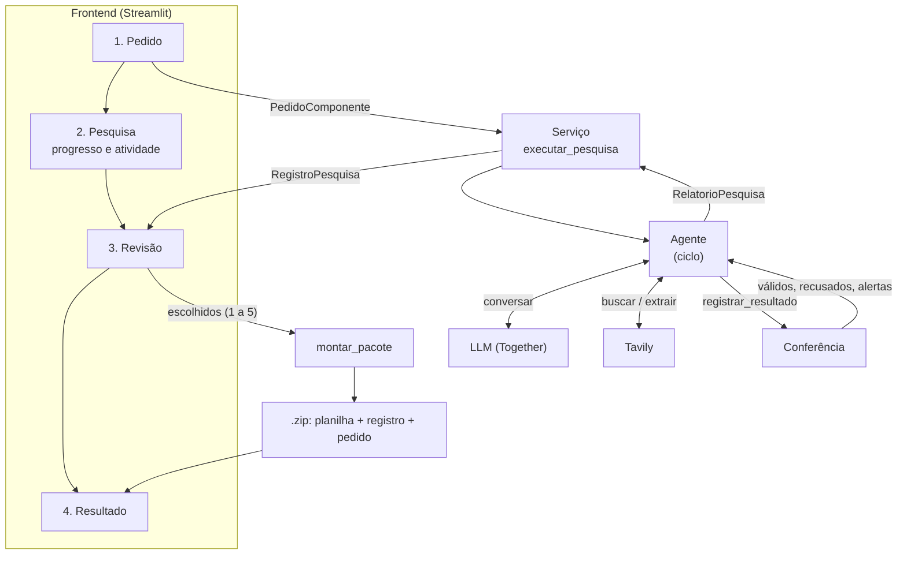
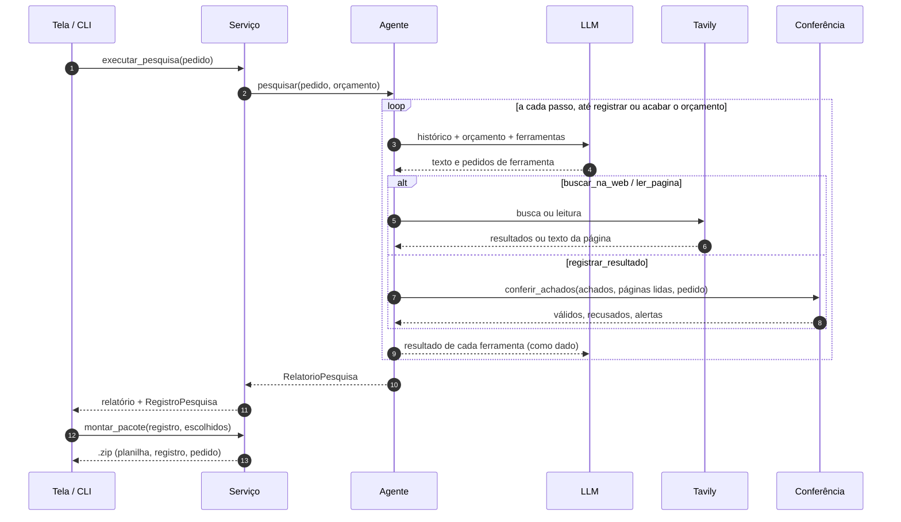

# Arquitetura

Este documento descreve o que o código faz hoje. As regras da conferência estão em [regras.md](regras.md).

## Componentes

| Componente | Arquivo | Responsabilidade |
|---|---|---|
| Cliente da LLM | `backend/compartilhado/together_client.py` | `conversar`: envia o histórico e as ferramentas à Together e devolve texto e pedidos de ferramenta. Traduz os erros do SDK em mensagens para o usuário e registra o uso no contador. |
| Cliente do buscador | `backend/pesquisa/tavily_client.py` | `buscar` (busca na web) e `extrair` (lê páginas, devolvendo só os trechos relevantes para um "foco"). Valida os resultados com Pydantic. |
| Agente | `backend/pesquisa/agente.py` | O ciclo de function calling: chama a LLM, executa as ferramentas pedidas, aplica o orçamento e devolve um `RelatorioPesquisa`. |
| Ferramentas | `backend/pesquisa/ferramentas.py` | Os argumentos de `buscar_na_web`, `ler_pagina` e `registrar_resultado` (modelos Pydantic que também geram o schema que a LLM vê) e as mensagens de erro de registro. |
| Prompt | `backend/pesquisa/prompts.py` | O prompt de sistema, em blocos (`_P_ABERTURA`, `_P_REGRAS`, `_P_ENTREGA`). |
| Conferência | `backend/pesquisa/conferencia.py` | A conferência determinística de cada achado contra as páginas lidas, e o resumo conferido. |
| Unidades | `backend/compartilhado/unidades.py` | Leitura de quantidades ("3,3 V", "100 mA") e comparação com o requisito, em aritmética decimal exata. |
| Eventos | `backend/pesquisa/progresso.py` | Mensagens curtas de atividade (passo, busca, leitura, registro, aviso) para o terminal e a tela. |
| Registro | `backend/pesquisa/registro.py` | O registro JSON de uma pesquisa: montar, salvar e carregar (com validação e limite de tamanho). |
| Planilha | `backend/planilhas/gera_planilha.py` | A planilha `.xlsx`, gerada em memória, com proteção contra injeção de fórmula. |
| Serviço | `backend/servico/pesquisa.py` | A porta de entrada do frontend e do CLI: `executar_pesquisa` (mede tempo e uso, monta o registro) e `montar_pacote` (o `.zip`). |
| Frontend | `frontend/` | A interface Streamlit em quatro etapas. A pesquisa roda numa thread (`execucao.py`) que nunca toca no estado da tela. |
| Demonstração | `backend/pesquisa/demo.py` | Repete uma execução gravada trocando só a LLM, a busca e a leitura (injetadas em `pesquisar`). |
| Sanitizador | `backend/pesquisa/sanitizar_registro.py` | Recorta uma gravação para virar exemplo público e confere que a conferência não muda. |

## Fluxo de dados

## O ciclo do agente

Cada **passo** é uma chamada à LLM, com o histórico, a mensagem de orçamento (`[orçamento] passo 3/15 · buscas 2/10 ·
leituras 4/15`) e as três ferramentas. A LLM responde com texto e/ou pedidos de ferramenta; o código executa cada
pedido e devolve o resultado. Os resultados de busca e de leitura vão embalados em JSON com o aviso de que são dado
externo; recusas e erros são mensagens curtas escritas pelo código.

- **Orçamento** (padrão): 15 passos, 10 buscas e 15 leituras. Busca ou leitura além do limite é recusada com
  mensagem. Consulta repetida (comparada normalizada) é recusada sem gastar orçamento. Uma página já lida (ou que já
  falhou) é devolvida do cache, sem gastar leitura.
- **Leitura**: o texto de cada página é cortado em 12 mil caracteres; é esse texto, o mesmo que a LLM vê, que a
  conferência usa como prova. Leitura que falhou ou veio vazia não conta como página lida. Redes sociais são recusadas.
- **Registro parcial** (`definitivo=false`): é conferido, e a LLM recebe o resultado da conferência e continua.
- **Registro definitivo** com menos de 3 válidos: a LLM recebe o que falta e os recusados com o motivo, e tem **uma**
  chance de revisar. O próximo registro definitivo encerra a pesquisa, com ou sem os 3.
- **Achados se acumulam** entre registros, sem repetir o MPN. Um recusado que passa numa revisão sai da lista de
  recusados. Os alertas de conferência de cada componente são os da conferência que valeu para ele.
- **Registro inválido** (Pydantic): volta à LLM com a lista de erros. Se o erro é de citação, a mensagem traz um
  exemplo de evidência correta; repetido em seguida, a mensagem fica mais firme ("2ª vez: ...").
- **Fim do orçamento**: uma chamada final com `tool_choice` que obriga `registrar_resultado`. Se esse registro vier
  inválido, há uma chamada extra de correção, fora do orçamento.
- **Resposta cortada por limite de tokens** (`finish_reason == "length"`): a resposta é descartada, a LLM é avisada para
  ser breve, e há uma nova tentativa no mesmo passo. Cortada de novo, o passo é descartado e o ciclo segue.
- **Falha da LLM** (tempo esgotado, chave recusada...): vira alerta e a pesquisa devolve o que já tiver.
- **Cancelamento**: um callback consultado antes de cada passo e de cada ferramenta.
- **Eventos de atividade**: com `ao_evento`, o ciclo emite eventos curtos (passo, fala da LLM, busca, leitura, leitura
  que falhou, registro, correção, aviso). Um callback com defeito nunca interrompe a pesquisa.

Parâmetros da chamada à LLM: modelo `zai-org/GLM-5.3-Flash`, temperatura 0,2, até 10 mil tokens de resposta e 240 s
de espera por chamada. O esforço de raciocínio só é enviado se escolhido (`low`, `high` ou `max`).

## Sequência de uma pesquisa

## O registro JSON

`RegistroPesquisa` (em `backend/pesquisa/registro.py`) guarda uma pesquisa inteira. Com ele é possível refazer a
conferência sem chamar nenhuma API, e é dele que a demonstração repete a conversa.

| Campo | Conteúdo |
|---|---|
| `versao` | a versão do sistema (`backend/compartilhado/versao.py`) |
| `inicio`, `fim`, `duracao_segundos` | quando a pesquisa rodou (UTC) e quanto durou |
| `modelo`, `esforco` | o modelo e o esforço de raciocínio usados |
| `pedido` | o pedido |
| `resultado` | achados válidos (com as evidências já conferidas), recusados com o motivo, alertas, resumo conferido e comentário da LLM |
| `orcamento` | os limites e quanto foi usado |
| `uso` | tokens de entrada, saída, em cache e de raciocínio, pedidos sem confirmação, créditos do Tavily e custo estimado |
| `passos` | cada passo: texto da LLM, tokens, cortes por limite de tokens e cada ferramenta com os argumentos e o resultado **completos** |
| `paginas` | `{url: texto}` de cada página lida com sucesso (o mesmo texto que a LLM recebeu) |
| `paginas_com_erro` | `{url: motivo}` das leituras que falharam |
| `demonstracao` | `true` quando o registro é (ou vem de) uma execução gravada repetida |

Ao carregar (`carregar_registro`), tudo é validado com `extra="forbid"`: um arquivo adulterado é recusado. O arquivo
tem limite total de 5 MB; acima disso, gravar ou carregar levanta um erro claro, e nada é cortado.
